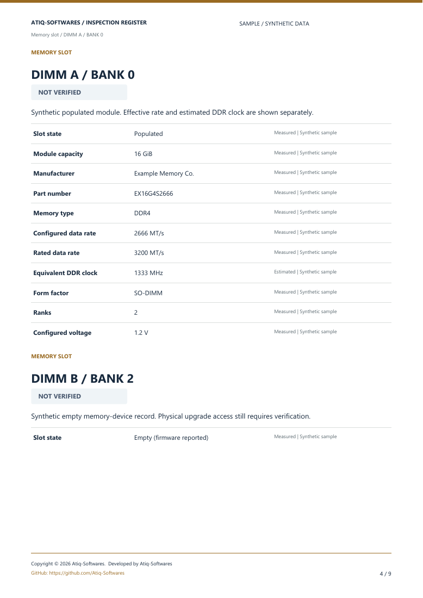
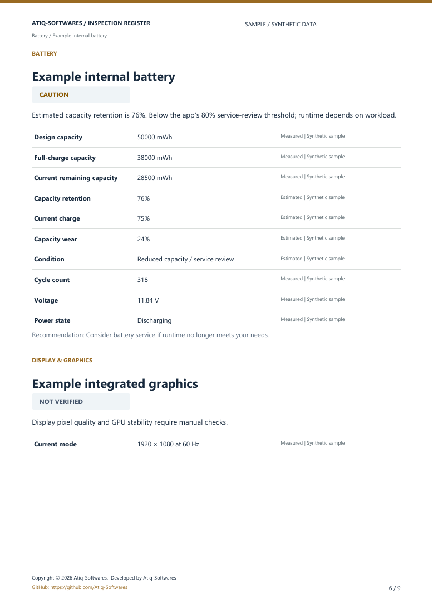

<p align="center"><strong>ATIQ-SOFTWARES</strong></p>
<h1 align="center">Atiq Laptop Inspector</h1>
<p align="center">Portable Windows hardware inspection and evidence-based reports.</p>
<h2 align="center"><a href="https://atiq-softwares.github.io/laptop-inspector/">Visit the website → Download the free Windows app</a></h2>
<p align="center"><strong>100% Free • Offline • No Installation • No Registration</strong></p>
<p align="center">
  <a href="https://atiq-softwares.github.io/laptop-inspector/"></a>
  <a href="LICENSE"></a>
</p>

> **Looking for the application?** Start at **[the official download website](https://atiq-softwares.github.io/laptop-inspector/)** for the Windows ZIP, screenshots and simple instructions.
> GitHub's **Code → Download ZIP** downloads the **source code**, not the ready-to-run application.
> [Direct v1.1.1 Windows x64 application ZIP](https://github.com/Atiq-Softwares/laptop-inspector/releases/download/v1.1.1/Atiq-Laptop-Inspector-v1.1.1-Windows-x64.zip) · [Official releases](https://github.com/Atiq-Softwares/laptop-inspector/releases/latest)

A native **C# / WPF** Windows hardware inspection application with an offline,
portable EXE, evidence-labelled assessments and professional PDF, HTML and JSON
reports. Developed and published by **Atiq-Softwares**.

**Download → Extract → Run EXE → Scan → Get report**


> This screenshot and the downloadable sample reports contain clearly labelled
> synthetic data. They are not measurements from a real laptop.

## Security update v1.1.1

This patch hardens diagnostic input and the optional SMART helper, writes reports
transactionally, adds a restrictive HTML content policy, and checks an explicit
release payload with locked dependencies. SHA-256 verification tools distinguish
integrity checks from publisher signatures. The application remains **unsigned**,
portable and offline, under the existing MIT license. Required third-party
notices and the GPL SMART-tool source remain included.

The release has 87 automated tests. Local Windows 11 x64 inspection, SMART reads,
portable startup and all three report formats passed. Windows 10 and a real UAC
approval remain device-qualification items; no all-model compatibility guarantee
is made. [Validation record](docs/TESTING.md) · [Release security](docs/RELEASE-SECURITY.md)

## Interface and hardware coverage introduced in v1.1

The interface uses an inspection-desk layout with a warm paper surface, graphite navigation and restrained brass accents. Device figures replace the earlier marketing-style overview. Battery and individual memory slots are visible together, followed by the drive register; the full hardware page can be filtered by category or searched by field/value.

The PDF has a dark title page, a factual specification summary, compact evidence tables, component context on continued pages and numbered operator/service sections. The new bundled read-only SMART reader substantially improves drive hours and wear coverage without installing a service. Integrity checks protect the bundled executable and database. Restricted reads can be retried through an explicit optional Windows permission flow.

A laptop brand/model does not guarantee that firmware, a controller or a USB bridge exposes every counter. Missing values remain unverified. The app never guesses an empty slot, drive hours or battery capacity.

## Get started

1. [Visit the official website](https://atiq-softwares.github.io/laptop-inspector/) and choose **Download Free for Windows**.
2. Extract **all** files to a normal local folder.
3. Double-click **`Atiq-Laptop-Inspector.exe`**.
4. Click **Start Full Inspection** and wait for the scan to finish.
5. Review **Hardware details** and complete **Manual checks**.
6. Open **Export reports** and save a PDF, HTML or JSON report.

**No installation, .NET installation, PowerShell commands, administrator account,
registration or internet connection is required for normal use.** Inspection time
depends on the Windows providers. A diagnostic worker is cancelled after three
minutes if providers stop responding. A scan can also be cancelled manually.

The EXE is **unsigned**. Windows Defender, SmartScreen or organizational application
controls may warn or block execution. Review the source and release checksum and
follow your organization's policy. Do not disable protection or bypass a block.

## What it inspects

| Area | Available information and honest limits |
| --- | --- |
| CPU | Model, manufacturer, cores, logical processors, reported clocks, L2/L3 cache; limited Intel generation inference and general-use suitability estimate. No benchmark. |
| Memory | Firmware-based per-slot inventory, including explicitly empty slots; manufacturer/part, DDR type, configured/rated MT/s, estimated DDR clock in MHz, ranks, voltage and widths. No inferred channel mode or integrity claim. |
| Storage | Read-only smartctl plus Windows providers: model, firmware, interface, capacity, operating hours, power cycles, temperature, wear, SMART status, available NVMe counters and vendor-labelled ATA attributes. Separate logical-volume used/free space. |
| Battery | Design/full-charge/remaining capacity, current charge, retained capacity, wear, cycles, voltage and charging state. Current charge and health are separate readings. |
| Display & GPU | Graphics adapter, driver, current resolution/refresh if reported. Pixel and GPU functional tests remain manual. |
| Board & BIOS | Manufacturer, board product/version and BIOS version/date. No firmware-security inference. |
| Windows & security | OS version/build, architecture, last boot, Secure Boot, available TPM/Defender/encryption configuration. No malware or online update scan. |
| Network | Physical network adapters, link states and supported local Bluetooth radio names. No internet or pairing test. |
| Sensors | Available ACPI thermal zones, clearly distinguished from CPU/GPU package temperature. No stress test or kernel driver. |

Guided manual checks cover the **keyboard, display, webcam, microphone, speakers,
touchpad, ports/connectivity and physical condition**. The app includes an in-memory
keyboard checker and a full-screen six-color display helper. Camera and audio
guides use Windows' own tools; the app does not record you.

## Read the results correctly

- 🟢 **GOOD**: the available reading meets the stated app policy, within its scope.
- 🟡 **CAUTION**: review the explanation and consider service or upgrades.
- 🔴 **CRITICAL**: investigate a critical reading or failed manual check.
- ⚪ **NOT VERIFIED**: functional condition or a required measurement is unknown.

Every measurement includes its **source** and an evidence label: **Measured**,
**Estimated**, **Unavailable** or **Manual**. “Measured” means Windows/firmware
reported; the app does not independently calibrate hardware sensors.

There is **no invented overall health percentage**. RAM capacity is not a memory
integrity test. CPU inventory is not a benchmark. Battery retention is not remaining
charge or a safety test. Storage “Healthy” is not a reliability guarantee. Unverified
components and pending manual checks prevent an overall GOOD assessment unless
the result is already a higher-priority warning or critical finding.

[Policy and architecture details](docs/ARCHITECTURE.md) · [Complete limitations](docs/LIMITATIONS.md)

## Reports worth keeping


- **PDF**: A4 layout, executive summary, component findings and evidence tables,
  manual results, warnings, service recommendations, coverage limits, branded
  headers/footers, page numbers and clickable GitHub links.
- **HTML**: a self-contained offline file with attractive cards, tables and print CSS.
- **JSON**: typed evidence, component evaluations, limitations, manual outcomes and
  the overall assessment for further processing.

A sample memory-device page and battery readout:





All exports include the inspection timestamp with UTC offset, manufacturer/model,
buying-suitability guidance and an explicit explanation of what remains unknown.
Report files are not digitally signed and do not guarantee future reliability.

[Download a synthetic sample PDF](https://github.com/Atiq-Softwares/laptop-inspector/releases/latest/download/Sample-Inspection-Report.pdf)

## Privacy and security

Everything runs locally. There is no telemetry, automatic upload, account, network
request during scanning/export, persistent agent or background service. GitHub links
open only when clicked. The app reads Windows providers and does not change system
settings, install drivers, flash firmware, erase data or run stress tests.

No passwords, tokens, Windows product keys, account names, addresses, SSIDs or personal files are queried. Firmware and SMART buffers can contain hardware identifiers during collection; the parser keeps only selected fields and never exports serials. Drive indices remain internal and are removed from all report exports. Manual notes are **excluded from
exports by default**; you may explicitly include them. Review free text before
sharing any report. Exports remain on disk until you choose to remove or share them.

## Compatibility

The portable release targets **Windows 10 22H2 x64 and Windows 11 x64**. The full
.NET 10 runtime is bundled; users do not install it. Runtime native libraries can
be extracted into Windows' temporary folder on first launch. Keep all legal notices
and the licenses folder with the EXE when redistributing the package.

Physical hardware compatibility varies by firmware, drivers, Windows permissions,
virtualization and USB/RAID bridges. Unsupported diagnostics remain explicitly
unavailable. An optional advanced-drive retry explains and requests Windows permission when standard SMART access is restricted. 32-bit and native ARM64 releases are not
provided in v1.1.1. Use a Windows release receiving appropriate security updates.

## Verify your download

The release includes **SHA256SUMS.txt** and a per-file payload manifest. A matching
checksum alone does not authenticate the publisher. The executable is unsigned. Compare the ZIP with a trusted local
SHA-256 tool. Optional PowerShell verification for technical users:

```powershell
Get-FileHash .\Atiq-Laptop-Inspector-v1.1.1-Windows-x64.zip -Algorithm SHA256
```

## Build and test from source

Developers need Windows, Git, **PowerShell 7.4+** for packaging and the **.NET 10 SDK** pinned by global.json. Normal app users need none
of these tools.

```powershell
git clone https://github.com/Atiq-Softwares/laptop-inspector.git
cd laptop-inspector
dotnet test LaptopInspector.slnx -c Release
./scripts/package.ps1
```

Packaging runs automated tests, publishes a self-contained single-file EXE,
checks real WPF startup, generates sample PDF/HTML/JSON, builds a ZIP, extracts
it to a fresh folder, checks the extracted EXE and writes SHA256SUMS.txt.

The [Windows GitHub Actions workflow](.github/workflows/release.yml) validates main,
security branches and pull requests using read-only permissions. It uploads test
results only and never publishes releases automatically. Releases require an
explicit approved publication; no tag-triggered publisher is enabled. [Validation details](docs/TESTING.md)
distinguish automated checks from unperformed physical laptop qualification.

## Source layout

```text
src/Inspector.Core    Models, evaluation, SMART parsing, privacy and sample fixture
src/Inspector.App     Native WPF UI, Windows collector and PDF/HTML/JSON exporters
tests/Inspector.Tests Boundary, missing-value, privacy, parser and report tests
scripts/package.ps1  Publish, extracted-startup verification, ZIP and SHA-256
docs/                Architecture, limitations, testing and release documentation
licenses/            Exact upstream legal notices for shipped dependencies
```

## License and publisher

**Copyright © 2026 Atiq-Softwares.**  
**Developed by Atiq-Softwares**  
**GitHub: https://github.com/Atiq-Softwares**

Original code and graphics: [MIT License](LICENSE). The separate smartctl executable is GPL-2.0-or-later; its unmodified corresponding source archive, licence and build instructions are included in every portable package. Other dependencies retain their
licenses; see [THIRD-PARTY-NOTICES.txt](THIRD-PARTY-NOTICES.txt) and `licenses/`.
